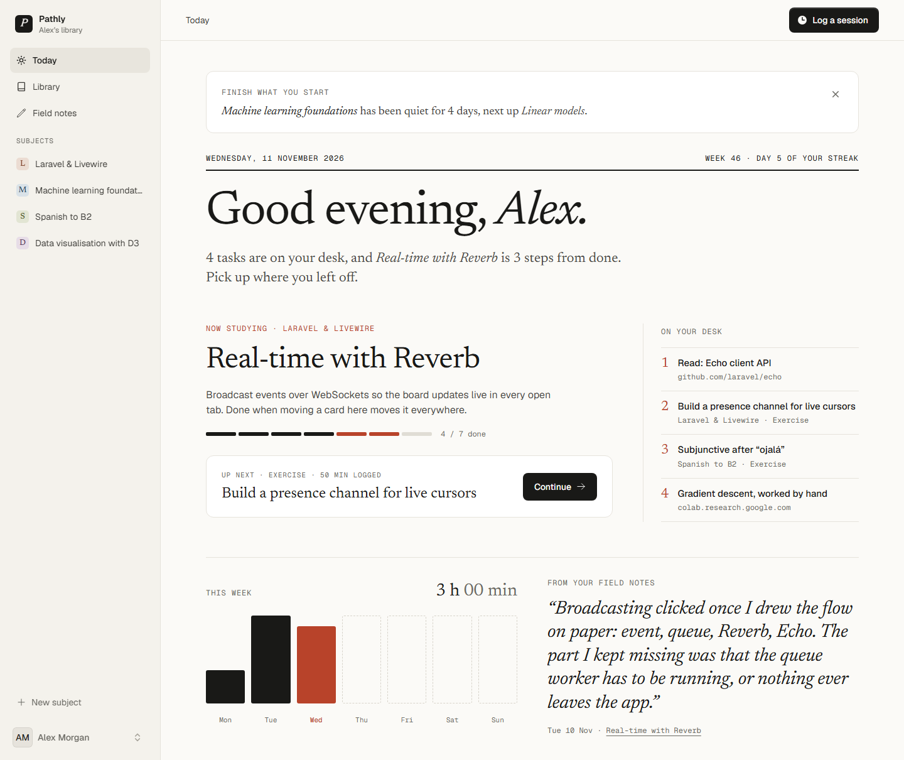
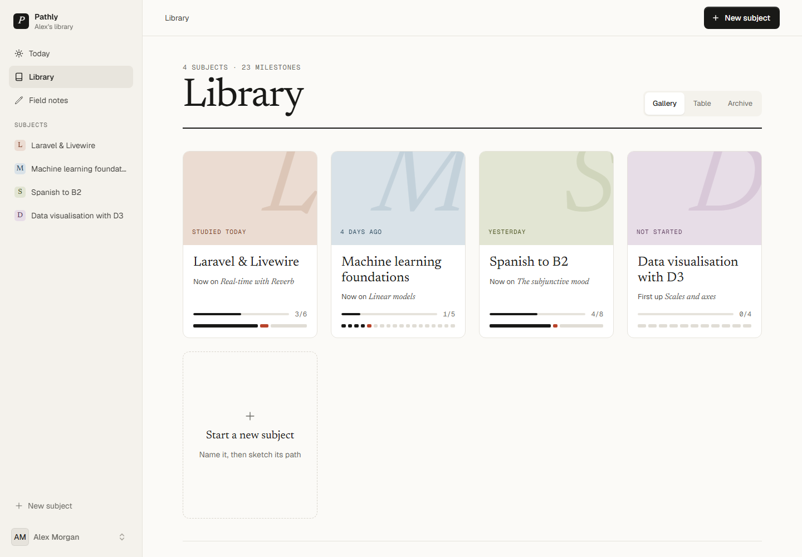
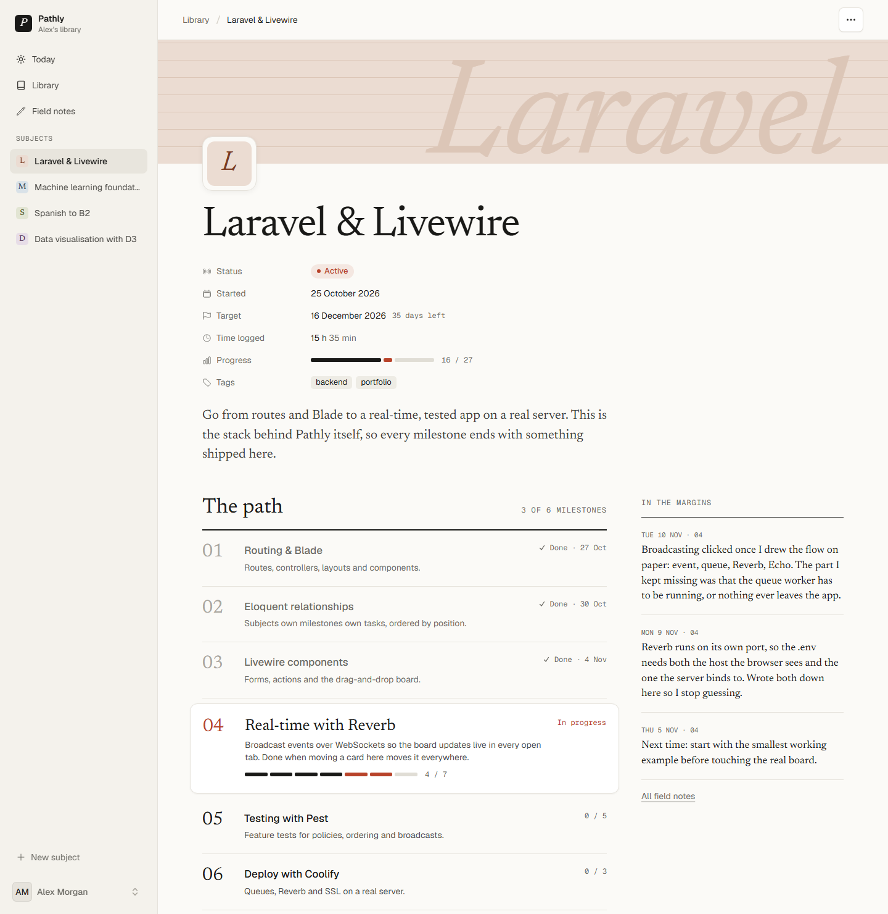
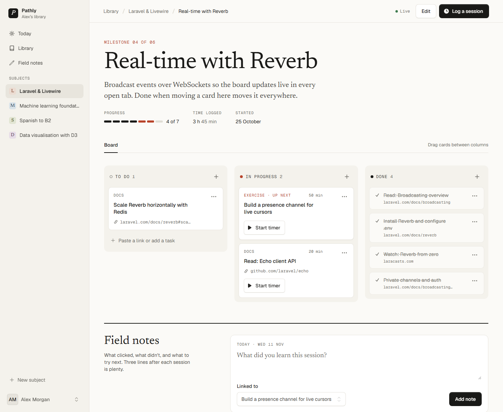
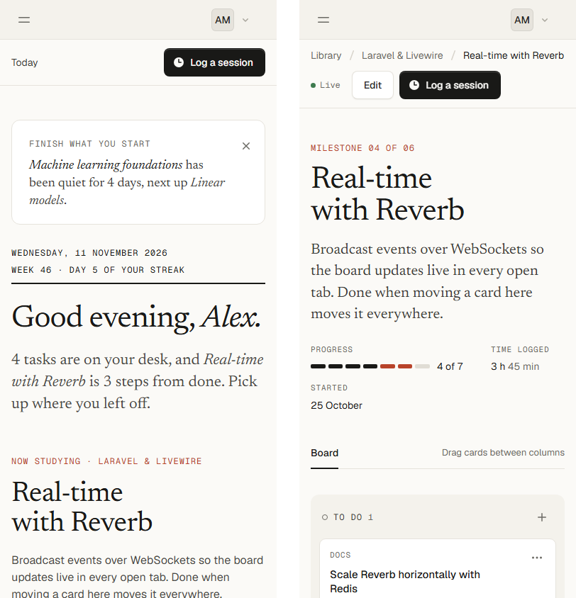
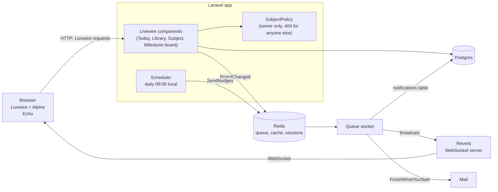
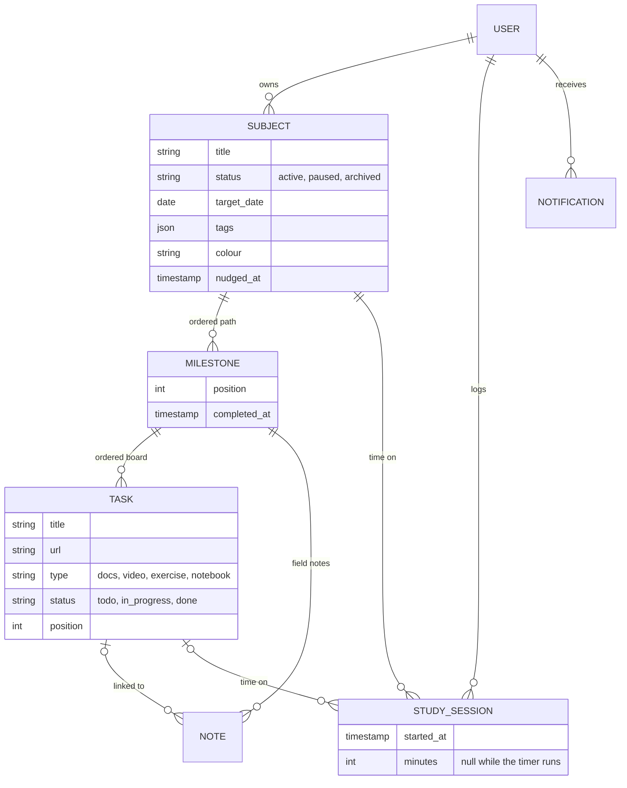
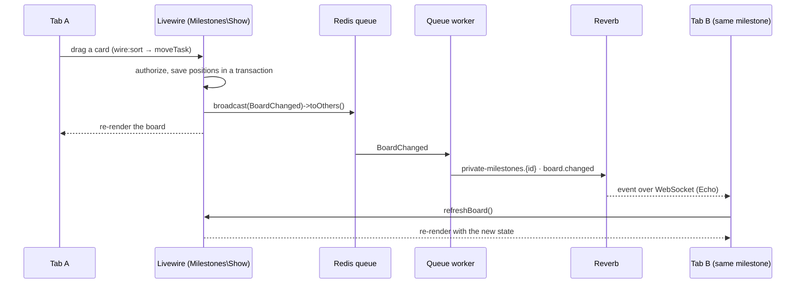

# Pathly

A learning-path tracker for people who teach themselves. Break a subject into an ordered path of milestones,
work through each milestone's tasks on a kanban board, log study time, and keep short field notes on what clicked.
When a subject you started goes quiet, Pathly nudges you to finish what you started.

Built with Laravel, Livewire, Postgres, Redis and Reverb.



## Features

- **Subjects, milestones and tasks.** A subject is a path of numbered milestones; each milestone holds tasks
  (docs, videos, exercises, notebooks) that move from To do to In progress to Done.
- **A kanban board per milestone.** Drag cards between columns or use the "Move to" menu. A milestone is finished
  when all of its tasks are done, and the path moves on to the next one.
- **Live updates.** Open the same board in two tabs or on two devices: a change in one appears in the other at
  once, over WebSockets (Laravel Reverb). A dot in the header shows whether the board is Live or Offline.
- **Study sessions.** Start a timer on a task or log time by hand. Sessions feed the streak, the week chart and the
  time logged on every subject and milestone.
- **Field notes.** A few lines after each session, optionally linked to the task you studied. The latest one is
  quoted on Today, recent ones sit in the subject's margins, and all of them are on the Field notes page.
- **Today.** One page with the subject you're on, what's up next, the in-progress tasks on your desk, the week's
  study time and your streak.
- **"Finish what you start".** Every morning a scheduled job looks for started subjects that have gone quiet and
  sends one reminder per person, by email and on Today. It reminds once per quiet spell, and you can turn it off.
- **Library.** Every subject as a card or in a table, with progress, the current milestone and the target date,
  plus the milestones you finished this month.

| Library | Subject |
| --- | --- |
|  |  |



It works on a phone too:



## Tech stack

| | |
| --- | --- |
| Backend | PHP 8.4, Laravel 13, Fortify (authentication, two-factor) |
| Frontend | Livewire 4 full-page components, Flux UI, Alpine.js, Tailwind CSS 4, Vite |
| Data | PostgreSQL 17 |
| Queues, cache, sessions | Redis 7 |
| Real-time | Laravel Reverb (WebSockets) and Laravel Echo |
| Mail and notifications | Laravel notifications (mail and database channels) |
| Quality | Pest, Larastan (level 7), Pint, GitHub Actions on Postgres |

## Architecture



There are no controllers or JSON API: every page is a Livewire full-page component (`app/Livewire`), and forms
are Livewire form objects shared between create and edit. Anything slow or external (broadcasting, the daily
reminder) goes through the Redis queue.

### Data model



Milestones and tasks are ordered by a `position` column. Moving a card renumbers its milestone's tasks in board
order inside one transaction. Anything that can be derived is: a milestone's number comes from a subquery
(`withNumber()`), progress from `withCount()`, and the current milestone is the first one not finished. The one
stored exception is `completed_at`: it's set when a milestone's last task is done and cleared when one is reopened,
so "Recently finished" can say when it happened.

### Real-time board



- The event carries only the milestone id. The receiving tab reloads the board through its own authorized
  request, so no task data travels over the socket.
- The private channel `milestones.{id}` is authorized with the same `SubjectPolicy` as the pages.
- `toOthers()` skips the tab that made the change, which has already re-rendered.

### "Finish what you start" reminders

`routes/console.php` schedules the queued `SendNudges` job daily at 09:00 in the display timezone. For each user
who wants reminders and has a verified email, it finds the subjects that are:

- active, started and not finished,
- quiet for at least `NUDGE_AFTER_DAYS` (default 3) local days, counting the last study session or task change,
- not already reminded about since they went quiet (`subjects.nudged_at`).

Each user gets one `FinishWhatYouStart` notification listing all of their quiet subjects, sent by mail and stored
in the `notifications` table, where Today shows it until it's dismissed. Users are loaded in chunks with their
subjects eager-loaded, and a test checks that the number of queries doesn't grow with the number of subjects.

### Decisions worth knowing

- **Time zones.** Timestamps are stored in UTC. "Today", streaks, the week chart and quiet days use local days in
  `APP_DISPLAY_TIMEZONE` (`App\Support\LocalTime`), so a session at 00:30 counts for the day it happened on.
- **404, not 403.** Another user's subject, milestone or reminder answers 404, so ids are never confirmed.
  Policies return `Response::denyAsNotFound()`, nested routes use `scopeBindings()`, and Livewire actions load
  records through the parent relationship instead of `find($id)`.
- **No N+1 queries.** Lazy loading throws outside production (`Model::preventLazyLoading()`), and the busy pages
  have tests that count queries.
- **Postgres in CI.** Tests run on in-memory SQLite locally for speed and on Postgres in GitHub Actions, which
  catches Postgres-only mistakes such as `ORDER BY` inside an aggregate.

## Getting started

Requirements: PHP 8.3+ with `pdo_pgsql` and `redis`, Composer, Node 22+, Docker.

```bash
git clone https://github.com/ivailipm/Pathly.git
cd Pathly

docker compose up -d        # Postgres on port 5433, Redis on 6379
composer setup              # install, .env from .env.example, app key, migrate, build assets
php artisan db:seed         # the demo library
```

Fill in `REVERB_APP_ID`, `REVERB_APP_KEY` and `REVERB_APP_SECRET` in `.env` with any random values, then run
`npm run build` again, since the browser reads the `VITE_REVERB_*` values at build time.

Run the app (each in its own terminal):

```bash
composer dev                # web server, queue worker and Vite
php artisan reverb:start    # WebSockets for the live board
php artisan schedule:work   # optional: the daily reminder
```

`composer dev` serves the app on http://127.0.0.1:8000; set `APP_URL` to match (or use Laravel Herd and
http://pathly.test). Log in as **test@example.com** with the password **password**.

The demo library has four subjects at different stages, three weeks of study sessions, field notes and one
reminder, all dated relative to today. Reset it at any time with `php artisan migrate:fresh --seed`.

To send the reminder once without waiting for 09:00:

```bash
php artisan tinker --execute "dispatch_sync(new App\Jobs\SendNudges)"
```

With `MAIL_MAILER=log` the email is written to `storage/logs/laravel.log`.

### Configuration

| Variable | Default | |
| --- | --- | --- |
| `APP_DISPLAY_TIMEZONE` | `Europe/Sofia` | Time zone for "today", streaks, the week chart and the reminder time |
| `NUDGE_AFTER_DAYS` | `3` | Quiet days before a started subject gets a reminder |
| `BROADCAST_CONNECTION` | `reverb` | `null` turns live updates off |
| `QUEUE_CONNECTION` | `redis` | Broadcasting and reminders need a running worker |

## Testing

```bash
composer test               # Pint, Larastan (level 7) and the Pest suite
php artisan test            # just the tests (in-memory SQLite, no Docker needed)
```

Feature tests cover every page and action, including authorization (other users get 404), validation, ordering
after drag and drop, broadcasting, the reminder rules around local midnight, and query counts. CI
(`.github/workflows/tests.yml`) runs the same checks against Postgres.

## Deployment

The plan is a Hetzner VPS managed with Coolify. Whatever the host, Pathly needs these processes running:

| Process | Command |
| --- | --- |
| Web | PHP-FPM or `php artisan serve` behind a web server, serving `public/` |
| Queue worker | `php artisan queue:work` |
| Scheduler | `php artisan schedule:run` every minute (or `php artisan schedule:work`) |
| WebSockets | `php artisan reverb:start`, behind the proxy for `wss://` |

On each deploy: `composer install --no-dev`, `npm ci && npm run build` (with the production `VITE_REVERB_*`
values), `php artisan migrate --force` and `php artisan optimize`. For a public demo, `php artisan db:seed --force`
adds the demo user.

## Project layout

```
app/
  Enums/          TaskStatus, TaskType, SubjectStatus, SubjectColour
  Events/         BoardChanged (broadcast on private-milestones.{id})
  Jobs/           SendNudges (daily reminder)
  Livewire/       Today, Subjects\Index|Show, Milestones\Show, Notes\Index, Sessions\LogSession, Forms\*
  Models/         User, Subject, Milestone, Task, StudySession, Note
  Notifications/  FinishWhatYouStart (mail + database)
  Policies/       SubjectPolicy
  Support/        LocalTime, Streak, WeekChart
database/seeders/ DemoSeeder (the demo library)
routes/           web.php, channels.php, console.php (schedule)
tests/Feature/    one folder per area
```
